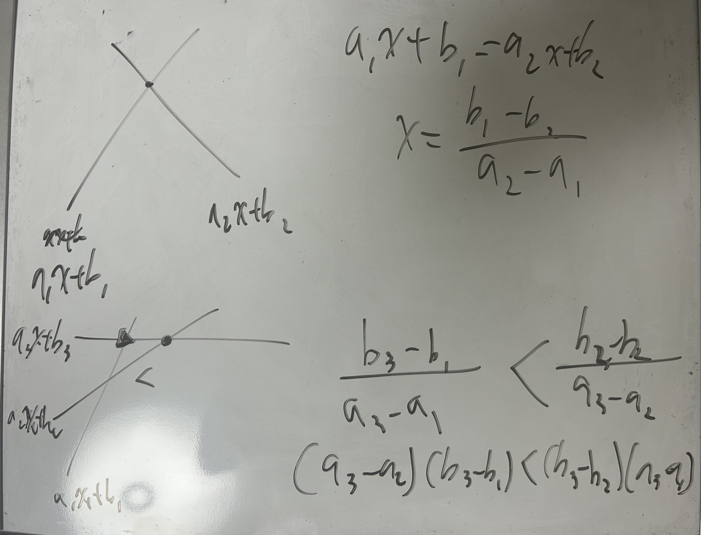

# Basic Theorem

CHT can be used as a geometrical technique to optimize a very specific case of DP. It can reduce time complexity from $O(n^2)$ to $O(n\log{n})$, sometimes even $O(n)$ for the following genre of transitions:

$$
dp[i] = \min_{j<i}(dp[j]+a_i\cdot b_j)
$$

Such transitions also work for $\max$, and are often derived from:

- Linear functions ( $y=ax+b$)
- Min, max queries
- Monotonicity

The key observation for optimization is that we only care about the minimum value at given $x$. We don’t need all lines, just the ones that could be the minimum at some point.

If we visualize the lines, the upper envelope (max) or lower envelope (min) forms a convex hull.

Redundant lines can be removed if they will never be part of the optimal answer again. This is why we maintain a convex hull of lines, either explicitly with a deque (offline) or implicitly with binary search (online).

Basically, we create a vector containing the relevant segments in order. Then we have a basic outline of the new $\min$ or $\max$ function we’ll be referencing. Let’s call if $f$. Now to get the value of $f(x)$, we basically have to find which sector, AKA the specific segment of the line value $x$ leads to. So when given $x$, we want to find specifically which line we’ll be referencing. To do this, we can use binary search. We’ll be searching across every line inside the hull vector. By comparing the x intersection with the previous line in the vector, we can see if this value is bigger or smaller than the given value. We’ll eventually come to the conclusion that the point is between two x intersections, which leads to the conclusion that it’s on a specific line segment.

# Base Implementation Analysis

First, we start off by sorting all lines in descending order by slope. Note, I’ll talk in the perspective of minimum. For maximum, you can simply flip terminology. Anyways, why is this? Well, we know that our final function will be a concave one. So the slope will be in decreasing order in our final function no matter what. Therefore, it’s logical to sort. In fact, it’s essential for computing which lines are relevant or irrelevant.

Now that we’ve sorted, we need to figure out which lines are relevant. We’ll progress in incremental order, starting from the 0th line. Note that this is just a process of building an upper hull. It will show a similar process of one shown in Andrew’s algorithm, though slightly different since we’re currently working with lines. Here’s the line of thought:

- Let’s say we already have two relevant lines. This is the minimal case. And since we’re going in incremental order, this should be the first two lines at the beginning.
- Now, we want to add a new line. To do this, following conditions should be met:
    - Let the first line in the relevant vector be notated by 1, and the second by 2. We’re attempting to add 3.
    - The intersection of 3 and 2 should be after 3 and 1 on the x axis for it to form a new edge on the hull. This means that the line is relevant, and we can push it in the vector.
    - However, if the intersection of 3 and 1 comes first, this means that 2 is now irrelevant. Thus, we can pop 2 out of the vector and add 3, which becomes the new 2.
- We can repeat this process for every line. However note, that we can pop until there are at least 2 left in the hull. You can pop more than one line if they’re not relevant, following the same rule.

We would need some precise double based functions for evaluating x intersections, but the general algorithm is as explained. Now that we’ve made our hull, all we have to do is binary search. You can modify this part based on the given problem.

The image below should explain the math clearly.

{: width="400"}

# DP - Based

Since we’ve tackled the very basics, it shouldn’t be too hard to understand how this concept works for DP. Recall the following transition:

$$
dp[i] = \min_{j<i}(dp[j]+a_i\cdot b_j)
$$

Note that this represents some sort of DP + a line with slope $b_j$. You can interpret this as a problem to find minimum cost where $b_j$ is cost and $a_i$ is the number of things. Below is a beautiful practice problem:

[https://www.acmicpc.net/problem/13263](https://www.acmicpc.net/problem/13263)

So our goal is to create a deque or vector of lines, where each line has slope of cost, and y intercept of the DP value. From then on, it’s the standard CHT problem. Refer to code for a more intuitive understanding.
