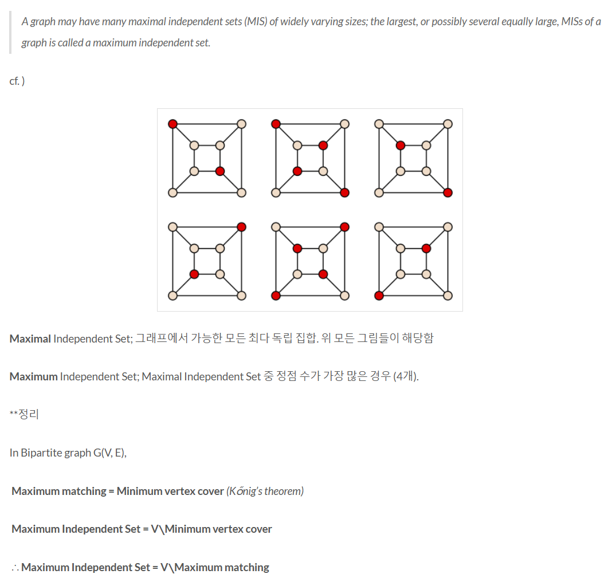

> In a bipartite graph, the MCBM (Maximum Cardinality Bipartite Matching) + MaxIS size = vertex count.
> 

MaxIS (Maximum Independent Set): The maximal set of vertices where there is no edge connecting two arbitrary vertices of the set.

In short, we use:

1. Kőnig’s theorem : MCBM = MVC
2. MaxIS = V - MVC

⇒ MCBM + MaxIS = V

{: width="400"}

[https://ali-ibrahim137.github.io/competitive/programming/2020/01/02/maximum-independent-set-in-bipartite-graphs.html](https://ali-ibrahim137.github.io/competitive/programming/2020/01/02/maximum-independent-set-in-bipartite-graphs.html)
