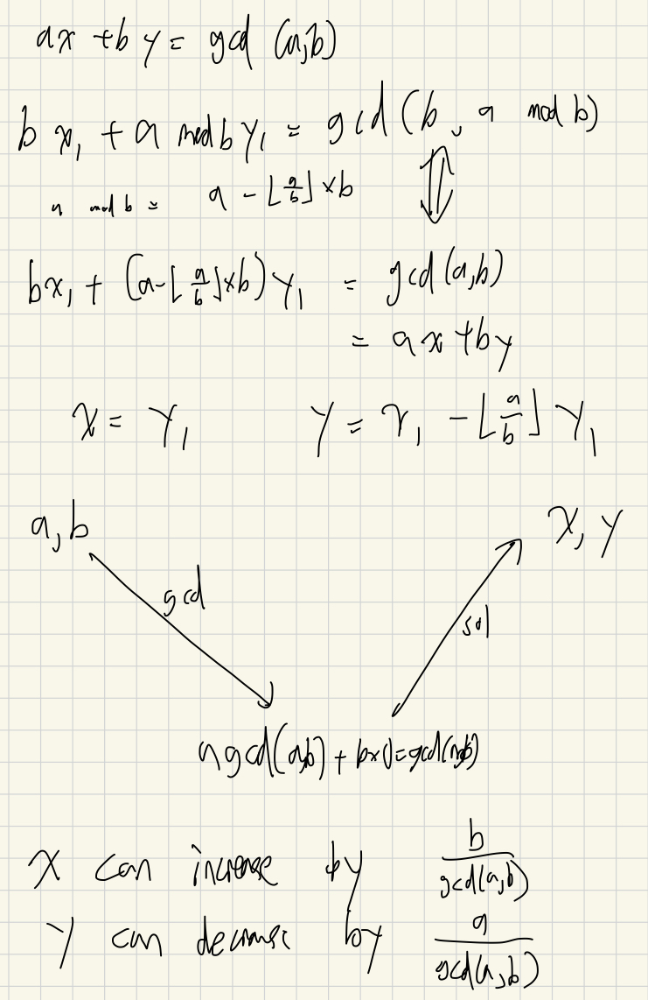
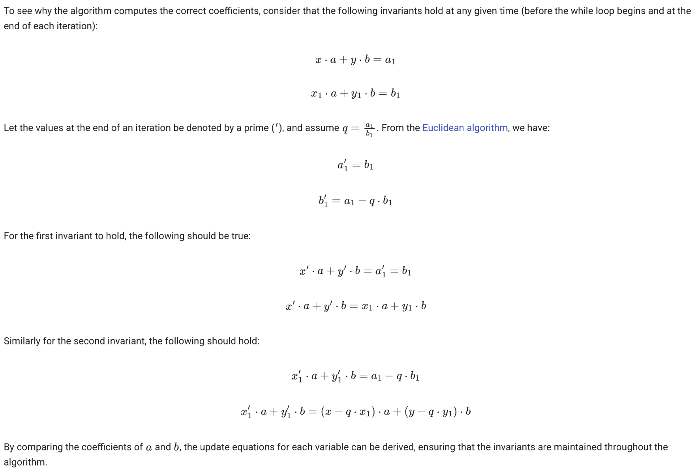

# Basics

Before going into the Extended Euclidean Algorithm, it’s required that you have a basic grasp on the Euclidean Algorithm in general.

Our goal is to find $\gcd(A,B)$. Basically, we need to find the maximum $k$ out of the set of all numbers where $k|A$ and $k|B$.

On a side note, $k|A$ means that $A$ is divisible by $k$.

An exclusive case is where one of $A$ and $B$ is 0. Then, by definition, the $\gcd$ is the non-zero integer.

The Euclidean Algorithm allows you to find the greatest common divisor of two numbers $a, b$ in $O(\log{\min(a,b)})$. Since $\gcd()$ is associative, you can chain this operation to find the greatest common divisor of more than two numbers in proportional time.

Originally, the Euclidean Algorithm is formulated as:

- Subtract the smaller number from the larger one until one of the numbers is zero.
- If $g$ divides $a$ and $b$, then $g$ also divides $a-b$.
- Therefore, we can say $\gcd(a,b) = \gcd(b, a-b)$

To optimize further:

- Since you can subtract $b$ a total of $\lfloor\frac{a}{b}\rfloor$ times, you can say $a-\lfloor\frac{a}{b}\rfloor\times b = a\mod{b}$
- Thus, the final form (say $a>b$):

$$
\gcd(a,b) = \gcd(b, a\mod{b})
$$

In code, it’s really simple:

```cpp
int gcd(int a, int b){
	return b ? gcd(b, a%b) : a;
}
```

We can extend this to $\operatorname{lcm}$ as well. We can say $\operatorname{lcm}(a,b) = \frac{ab}{\gcd(a,b)}$

So, all we need is a good $\gcd$ function and we can simply say:

```cpp
int lcm(int a, int b){
	return a / gcd(a,b) * b; //operation order for avoiding integer overflow
}
```

# Binary GCD

$O(\log{\min(a,b)})$ does seem really quick, but since this is a basic number we’d want to reduce this further. We can use something called Binary GCD.

The Euclidean Algorithm is slowed down because of the fact that modulo operators are slower than other algebraic operations and are not $O(1)$ in reality.

To speed things up, we can use two more properties of $\gcd(a,b)$:

- If both numbers are even, we can factor them out. $\gcd(2a,2b) = 2\gcd(a,b)$
- If one of the numbers is even, you can remove a factor of 2 since it isn’t a part of the $\gcd$.
 $\gcd(2a, b) = \gcd(a,b)$
- Our previous property is applied when both numbers are odd.

And here’s the finalized code:

```cpp
int binaryGCD(int a, int b) {
    if (a == 0) return b;
    if (b == 0) return a;

    int shift = __builtin_ctz(a | b); // Count common trailing zeros
    a >>= __builtin_ctz(a); // Remove trailing zeros from a
    b >>= __builtin_ctz(b); // Remove trailing zeros from b

    while (a != b) {
        if (a > b) swap(a, b);
        b -= a;
        b >>= __builtin_ctz(b); // Remove trailing zeros
    }
    
    return a << shift; // Restore common factor of 2
}
```

# Extended Euclidean Algorithm

Because of <u>**Bézout's Identity**</u>, stating that if $k$ is the greatest common divisor of $a, b$, there exists $x,y$ so that $ax + by = k$

We can rewrite this as $ax + by = \gcd(a,b)$

Note our goal is to find $(x,y)$ for that equation. Now to compute this. The original Euclidean Algorithm ended when $b=0$. Here we know that $ax + 0 = a$ therefore $x = 1$. 

Starting with $(x,y) = (1,0)$, we want to go backwards up the recursive calls. For each step, we need to figure out the transition of the coefficients $x, y$ during $(a,b) \to (b, a\mod{b})$

Let $x_1, y_1$ be the coefficients for $(b,a\mod{b})$ and we want to figure out $x, y$:

- $bx_1 + (a\mod{b})y_1 = g$
- $ax + by = g$
- $a\mod{b} = a-\lfloor\frac{a}{b}\rfloor\cdot b$
- $g = bx_1+(a\mod{b})y_1 = bx_1 + (a-\lfloor\frac{a}{b}\rfloor\cdot b)y_1$
- $g=a\cdot y_1 + b\cdot(x_1-\lfloor\frac{a}{b}\rfloor y_1)$

Thus, $x = y_1$ and $y=x_1-\lfloor\frac{a}{b}\rfloor\cdot y_1$

Below is my personal proof note:

{: width="400"}

Here’s a recursive implementation:

```cpp
int gcd(int a, int b, int& x, int& y) {
    if (b == 0) {
        x = 1;
        y = 0;
        return a;
    }
    int x1, y1;
    int d = gcd(b, a % b, x1, y1);
    x = y1;
    y = x1 - y1 * (a / b);
    return d;
}
```

And an iterative:

```cpp
int gcd(int a, int b, int& x, int& y) {
    x = 1, y = 0;
    int x1 = 0, y1 = 1, a1 = a, b1 = b;
    while (b1) {
        int q = a1 / b1;
        tie(x, x1) = make_tuple(x1, x - q * x1);
        tie(y, y1) = make_tuple(y1, y - q * y1);
        tie(a1, b1) = make_tuple(b1, a1 - q * b1);
    }
    return a1;
}
```

Explanation is made clear with:

{: width="400"}
