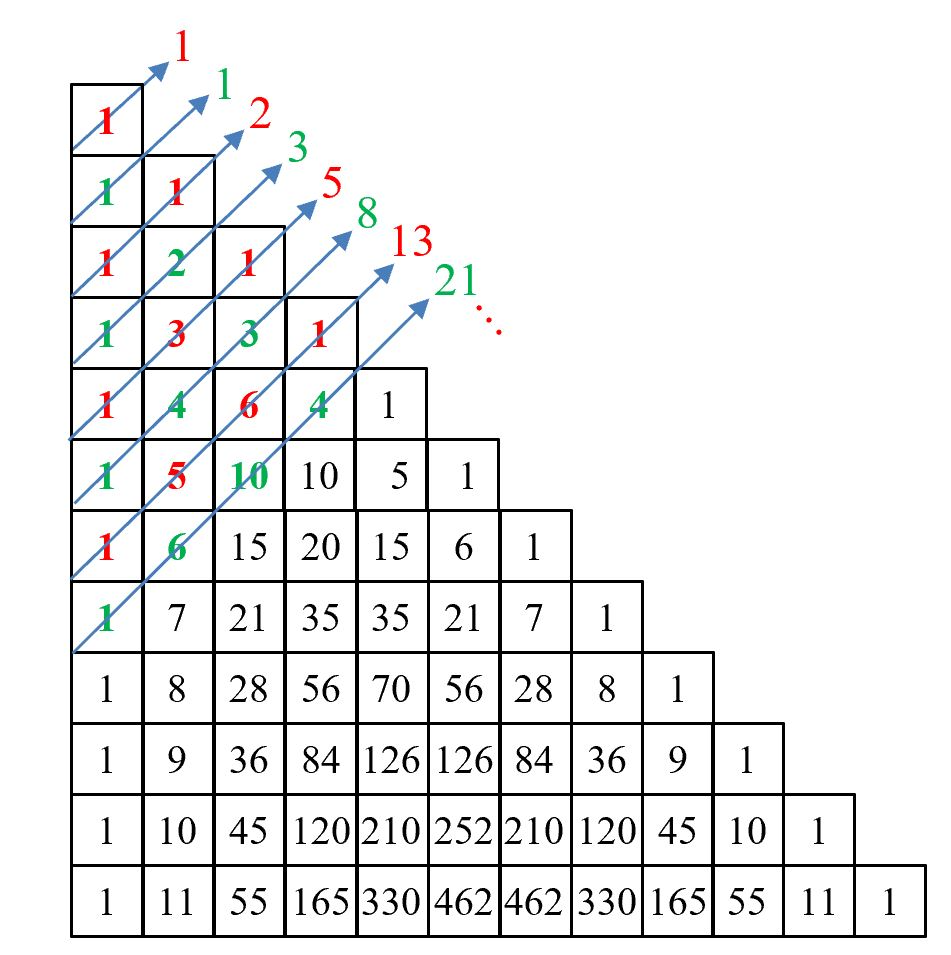

Definition: Binomial coefficients $\binom{n}{k}$ are the number of ways to select a set of $k$ elements without taking into account the order of arrangement from $n$ elements. In other words, the number of unordered sets.

# Binomial Theorem

Binomial coefficients get it’s name from the binomial theorem, where these represent the coefficients when expanding $(a+b)^n$

$$
(a+b)^n = \binom{n}{0}a^nb^0 + \binom{n}{1}a^{n-1}b^1 + ... + \binom{n}{i}a^{n-i}b^i + ... + \binom{n}{n}a^0b^n
$$

The pascal triangle represents these binomial coefficients.

# Calculation

$$
\binom{n}{k} = \frac{n!}{k!(n-k)!}
$$

This is the exact same as $C$. Proof is trivial, so I’ll skip.

# Properties

1. Recurrence formula, easy to deduce from analytical formula and is the basis of Pascal’s triangle.
    
    $\binom{n}{k} = \binom{n-1}{k-1} + \binom{n-1}{k}$
    
    This would be the upper left and upper units in the pascal triangle
    
2. Symmetry rule: $\binom{n}{k} = \binom{n}{n-k}$
3. Factoring in: $\binom{n}{k} = \frac{n}{k}\binom{n-1}{k-1}$
4. Sum over $k$: $\sum_{k=0}^{n}\binom{n}{k} = 2^n$
5. Sum over $n$: $\sum_{m=0}^{n}\binom{m}{k} = \binom{n+1}{k+1}$
6. Sum over $n$ & $k$: $\sum_{k=0}^{m}\binom{n+k}{k} = \binom{n+m+1}{m}$
7. Sum of the squares: $\binom{n}{0}^2 + \binom{n}{1}^2 + ... + \binom{n}{n}^2 = \binom{2n}{n}$
8. Weighted sum: $1\binom{n}{1} + 2\binom{n}{2} + ... + n\binom{n}{n} = n2^{n-1}$
9. Fibonacci: 
    
    $$
    \binom{n}{0} + \binom{n-1}{1} + ... + \binom{n-k}{k} + ... + \binom{0}{n} = F_{n+1}
    $$
    
    {: width="400"}
    

# Standard Computation

1. The naive methods isn’t even worth coding, but first of all it’s slow and since it requires heavy multiplication you can only use it with long oftentimes.
2. Instead of multiplying then dividing, we can carefully use doubles to do multiplication and division one by one.
    
    ```cpp
    int C(int n, int k) {
        double res = 1;
        for (int i = 1; i <= k; ++i)
            res = res * (n - k + i) / i;
        return (int)(res + 0.01);
    }
    //we add 0.01 since values can often be 0.999...
    ```
    
3. Pascal’s triangle can be used for an $O(n^2)$ computation. You can just DP this one.
4. Or, you can precompute and fetch in $O(1)$ with pascal’s for specific cases.

# Computing binomial coefficients modulo $m$

1. For small $n$s, you can use the Pascal approach.
2. For larger $n$s, you can precompute a list of factorials and apply the standard binomial coefficient formula along with the modulo. Here, we can basically do the computation itself in basically $O(1)$ time if we also calculate the inverse factorials.

Specific problem: Modulo prime power.

Say the prime power is $m = p^b$. If $p > \max(k, n-k)$, then we can use previously discussed methods.

However if $p\le \max(k,n-k)$, then at least one of $k!$  and $(n-k)!$ is not coprime with $m$. Thus, we cannot compute the inverses since they don’t exist.

- If it’s hard to understand, look up inverse modulus.
