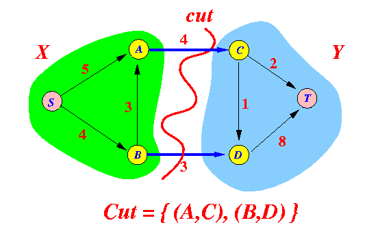

> The maximum amount of flow passing from the source to the sink is equal to the total weight of the edges in a minimum cut.
> 

{: width="400"}

To find the Min-Cut itself inside the graph, you can traverse the graph with BFS with a break function that is called when you encounter a saturated edge. This is because you can think of the Min-Cut as a sort of funnel.

```cpp
		void bfs(){
        q.push(s);
        fill(level.begin(), level.end(), 0);
        while(!q.empty()){
            int v=q.front();
            q.pop();
            level[v] = 1;

            for (int id : adj[v]) {
                if(level[edges[id].u]==0 && edges[id].cap > edges[id].flow){
                    q.push(edges[id].u);
                }
            }
        }
    }
```
