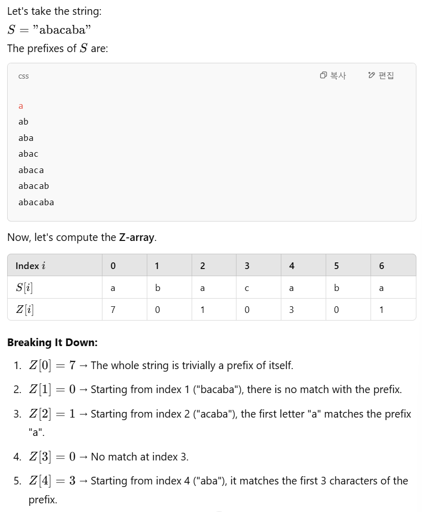

It took me some time to comprehend what the Z-function even is. But basically, it’s an array where $z[i]$ represents how many prefixes of the string $s$ itself exist in $s[i, ..., n-1]$.

{: width="400"}

Now that we know what it is, we want to compute it in $O(n)$ time.

# Implementation

The trivial approach would run in $O(n^2)$, and the approach is pretty obvious:

```cpp
vector<int> z_function_trivial(string s) {
    int n = s.size();
    vector<int> z(n);
    for (int i = 1; i < n; i++) {
        while (i + z[i] < n && s[z[i]] == s[i + z[i]]) {
            z[i]++;
        }
    }
    return z;
}
```

This should be simple to understand intuitively with the code.

However, we want efficient implementation. To achieve such, we will compute the values of $z[i]$ in turn from $i=1$ to $n-1$, but at the same time, when computing a new value we’ll try to make the best use of the previously computed values.

For the sake of brevity, let’s call “segment matches” the substrings that coincide with a prefix of $s$. The value $z[i]$ is then the length of the segment match starting at position $i$ and ending at position $i+z[i]-1$.

To do this, we’ll keep the $[l, r)$ indices of the rightmost segment match. This should remind you of Manacher’s, and in fact the two algorithms are structure-wise very similar. Basically, anything beyond $r$ is unknown.

Then, for index $i$ we want to figure out the value $d[i]$ of:

- If $i \ge r$, it means the current position is outside of what we’ve processed. Then, we can simply compute $z[i]$ with the trivial algorithm by comparing values one by one. Update $[l, r)$ after that.
- If $i<r$, it means the current position is inside the current segment match $[l, r)$. Then, we can use the already calculated Z-values to initialize the value of $z[i]$ to some sort of value.
For this, we observe that the substrings $s[l..r)$ and $s[0...r-1)$ match, as in they’re the same because it’s the definition. This means that as an initial approximation for $z[i]$ we can take the value already computed for the corresponding segment $s[0...r-1)$ which is $z[i-l]$.
However, this could be too large. when applied to position $i$ it could exceed index $r$. So, we must say $z_0[i] = \min(r-i, z[i-l])$
- After initializing $z[i]$ as $z_0[i]$, we try to increment $z[i]$ by running the trivial algorithm.

# Implementation

```cpp
vector<int> z_function(string s) {
    int n = s.size();
    vector<int> z(n);
    int l = 0, r = 0;
    for(int i = 1; i < n; i++) {
        if(i < r) {
            z[i] = min(r - i, z[i - l]);
        }
        while(i + z[i] < n && s[z[i]] == s[i + z[i]]) {
            z[i]++;
        }
        if(i + z[i] > r) {
            l = i;
            r = i + z[i];
        }
    }
    return z;
}
```

The code should be read out and comprehended easily.

By case division, you can prove that this algorithm runs in $O(n)$, mainly because the inner while loop only makes the $r$ pointer advance to the right. But then, the inner loop won’t make more than $n-1$ iterations in total because the $r$ pointer can’t advance further than that. Beautiful proof.

# Applications

- Search the substring
- Number of distinct substrings in a string
- String compression
