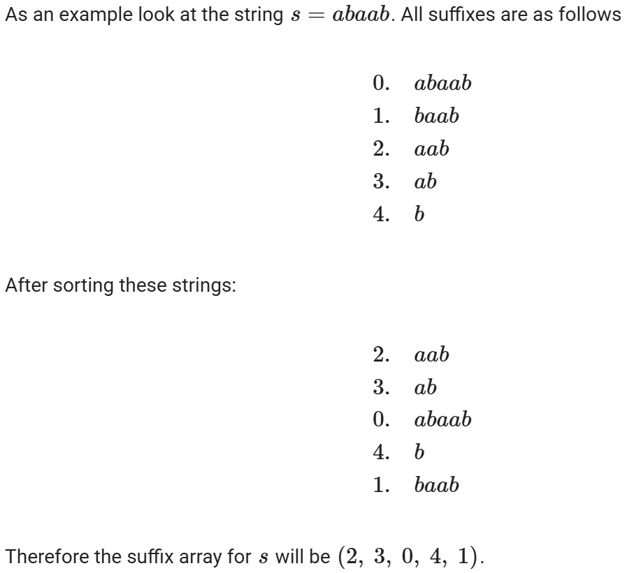
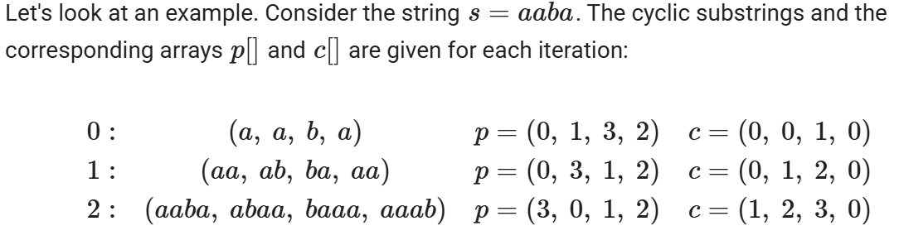

Let $s$ be a string of length $n$. Then, the $i$th suffix of $s$ is the substring $s[i...n-1]$

A suffix array will contain integers that represent the starting indexes of all the suffixes of a given string, after the aforementioned suffixes are sorted.

{: width="400"}

# Construction

The most naive approach would be to get all suffixes and to sort them. But sorting isn’t efficient since sorting uses $O(n\log n)$ comparisons and comparison itself costs $O(n)$ time, so the final complexity is $O(n^2\log{n})$.

Our goal is to come up with an $O(n\log{n})$ approach. So, instead of sorting the suffixes, it will sort the cyclic shifts of a string. We can very easily derive an algorithm for sorting the suffixes from it: just append an arbitrary character to the end of the string which is smaller than any character from the string. The order of the sorted cyclic shifts is equivalent to the order of the sorted suffixes.

$$
\begin{array}{lll} 1. & abbb\$d & abbb \\ 4. & b\$dabb & b \\ 3. & bb\$dab & bb \\ 2. & bbb\$da & bbb \\ 0. & dabbb\$ & dabbb \end{array}
$$

We will use the notation $s[i...j]$ for the substring of $s$ even if $i>j$ regardless of what we really mean.

The algorithm performs $\lfloor \log{n} \rfloor + 1$ iterations. For each $k$th iteration, we sort the $n$ cyclic substrings of $s$ of length $2^k$. So after all iterations, all cyclic shifts will be sorted. 

We will have a permutation array $p[0...n-1]$ where $p[i]$ is the index of the $i$th substring in the sorted array, and also an array $c[0...n-1]$ where $c[i]$ corresponds to the equivalence class to which the substring belongs. Basically, $c$ categorizes same substrings. This is because some substrings will be identical, and the algorithm needs to treat them equally. Also, when storing substrings in $c$, we’ll preserve information about the order in assignment so that if one substring is smaller than the other, then it should also have a smaller class label.

{: width="400"}

# Implementation

Now to work on implementation. We’ll write a function that takes string $s$ and returns the permutations of the sorted cyclic shifts.

At the beginning we must sort the cyclic substrings of length 1. This means we have to sort all characters of the string and divide them into equivalence classes. We can use counting sort for this. 

```cpp
    vector<int> p(n), c(n), cnt(max(alphabet, n), 0);
    for (int i = 0; i < n; i++)
        cnt[s[i]]++;
    for (int i = 1; i < alphabet; i++)
        cnt[i] += cnt[i-1];
    for (int i = 0; i < n; i++)
        p[--cnt[s[i]]] = i;
    c[p[0]] = 0;
    int classes = 1;
    for (int i = 1; i < n; i++) {
        if (s[p[i]] != s[p[i-1]])
            classes++;
        c[p[i]] = classes - 1;
    }
```

Now that we have completed our initial step, we want to create a general expansion. Basically, compute the $k$th iteration based off the $k-1$th iteration in $O(n)$ time. This is because there are $O(\log{n})$ steps and we want to achieve $O(n\log{n})$. 

To achieve this, note that the cyclic substrings of length $2^k$ consist of two substrings from the previous step with length $2^{k-1}$. To compare new substrings starting at position $i, j$ of length $2^k$, all we need to compare is $(c[i], c[i+2^{k-1}])$ and $(c[j], c[j+2^{k-1}])$.

$$
\dots \overbrace{ \underbrace{s_i \dots s_{i+2^{k-1}-1}}_{\text{length} = 2^{k-1},~ \text{class} = c[i]} \quad \underbrace{s_{i+2^{k-1}} \dots s_{i+2^k-1}}_{\text{length} = 2^{k-1},~ \text{class} = c[i + 2^{k-1}]} }^{\text{length} = 2^k} \dots \overbrace{ \underbrace{s_j \dots s_{j+2^{k-1}-1}}_{\text{length} = 2^{k-1},~ \text{class} = c[j]} \quad \underbrace{s_{j+2^{k-1}} \dots s_{j+2^k-1}}_{\text{length} = 2^{k-1},~ \text{class} = c[j + 2^{k-1}]} }^{\text{length} = 2^k} \dots
$$

That leads to the simple solution: to sort the substrings of length $2^k$ by these pair of numbers. This will give us the required order. However, a normal sort runs in $O(n\log n)$ time. This gives us a $O(n\log^2n)$ algorithm.

Counting sort should do the job, but we can base our technique off radix sorting for an even better constant. To sort the pairs we first sort them by second halves, then the first halves. However the second halves were already sorted in the previous iteration. Thus, we just need to subtract $2^{k-1}$ from the indices in $p$ to sort the pairs by the second halves. After that, we need to perform a stable sort by the first halves which can be accomplished with counting sort.

To compute the equivalence, just iterate over the sorted $p$ and compare its neighboring pairs.

```cpp
    vector<int> pn(n), cn(n);
    for (int h = 0; (1 << h) < n; ++h) {
        for (int i = 0; i < n; i++) {
            pn[i] = p[i] - (1 << h);
            if (pn[i] < 0)
                pn[i] += n;
        }
        fill(cnt.begin(), cnt.begin() + classes, 0);
        for (int i = 0; i < n; i++)
            cnt[c[pn[i]]]++;
        for (int i = 1; i < classes; i++)
            cnt[i] += cnt[i-1];
        for (int i = n-1; i >= 0; i--)
            p[--cnt[c[pn[i]]]] = pn[i];
        cn[p[0]] = 0;
        classes = 1;
        for (int i = 1; i < n; i++) {
            pair<int, int> cur = {c[p[i]], c[(p[i] + (1 << h)) % n]};
            pair<int, int> prev = {c[p[i-1]], c[(p[i-1] + (1 << h)) % n]};
            if (cur != prev)
                ++classes;
            cn[p[i]] = classes - 1;
        }
        c.swap(cn);
    }
    return p;
}
```

To generate the sorted order of the suffixes now that we’ve sorted the cycle shifts, you can append a character that is smaller than all others, then sort this result string by cycle shifts.

```cpp
vector<int> suffix_array_construction(string s) {
    s += "$";
    vector<int> sorted_shifts = sort_cyclic_shifts(s);
    sorted_shifts.erase(sorted_shifts.begin());
    return sorted_shifts;
}
```

Tbh in general, I get the feel, but I don’t think I understood it in essence fully. Like I get the point.

# Applications

# Longest Common Prefix Array Building

We want to create something called an LCP array, meaning the Longest Common Prefix array. An LCP’s definition follows its name, and in an LCP array, the length of the LCP of the two neighboring suffixes in sorted order are stored. Using an LCP array, you can find the length of the LCP of two arbitrary suffixes, say $p[i]$ and $p[j]$ by doing $\min(lcp[i], lcp[i+1], ..., lcp[j-1])$. This can be done efficiently with whatever RMQ data structure like a segment tree. But our main focus for now is building this $lcp$ array.

Using <u>**Kasai’s algorithm**</u>, we can compute this array in $O(n)$ time. 

Let’s look at two adjacent suffixes in the sorted order. Let their starting positions be $i, j$ and their $lcp$ equal to $k$. If we remove the first letter of both suffixes, which means we take the suffixes $i+1, j+1$, then the $lcp$ of the two should be $k-1$. However we can’t immediately write that to the array since these two suffixes might not be next to each other in sorted order. The suffix $i+1 < j+1$ obviously, but there might be some suffixes between them. However, since we know that the LCP between two suffixes is the minimum value of all transitions, we also know that the LCP between any two pairs in that interval has to be at least $k-1$, especially also between $i+1$ and the next suffix. It could even be bigger, we just know the minimum.

To implement this, iterate over the suffixes in order of their length. This way we can reuse the last value $k$, since going from suffix $i$ to $i+1$ is exactly the same as removing the first letter. By using another array, say $rank$, we can get the position of a suffix in the sorted list of suffixes.

```cpp
vector<int> lcp_construction(string const& s, vector<int> const& p) {
    int n = s.size();
    vector<int> rank(n, 0);
    for (int i = 0; i < n; i++)
        rank[p[i]] = i;

    int k = 0;
    vector<int> lcp(n-1, 0);
    for (int i = 0; i < n; i++) {
        if (rank[i] == n - 1) {
            k = 0;
            continue;
        }
        int j = p[rank[i] + 1];
        while (i + k < n && j + k < n && s[i+k] == s[j+k])
            k++;
        lcp[rank[i]] = k;
        if (k)
            k--;
    }
    return lcp;
}
```

Reading through the code should help refresh.

Since we decrease $k$ at most $O(n)$ times, and the LCP between two strings is at most $n-1$, we will also increase $k$ only $O(n)$ times. Therefore the algorithm runs in $O(n)$ time.
