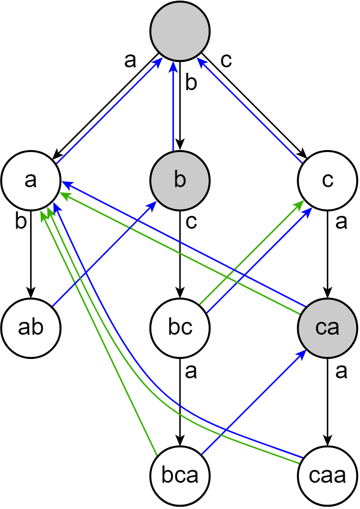

Concept: Create a trie of a set of words, so when given a string figure out what words exist in the string.

Construct a trie standardly. This step shouldn’t be hard. The concept-wise, most significant part of Aho-Corasick is the usage of suffix links. Make edges from certain vertexes to the longest proper suffix. You can do this in linear time.

{: width="400"}

Ignore the green arrows, but notice the behavior of the blue arrows.

# Implementation with Recursion

Since the trie part is trivial, we’ll focus on how to find the suffix links and computation when given a string. For the first implementation, we can follow the following rule:

- If $p$ is the ancestor of $v$ in the trie with $c$ being the letter labeling the edge $p\to v$, then $v$’s suffix link connects to the vertex of $p$’s suffix link and a $c$ appended.

Below is CP-Algorithm sample code:

```cpp
const int K = 26;

struct Vertex {
    int next[K];
    bool output = false;
    int p = -1;
    char pch;
    int link = -1;
    int go[K];

    Vertex(int p=-1, char ch='$') : p(p), pch(ch) {
        fill(begin(next), end(next), -1);
        fill(begin(go), end(go), -1);
    }
};

vector<Vertex> t(1);

void add_string(string const& s) {
    int v = 0;
    for (char ch : s) {
        int c = ch - 'a';
        if (t[v].next[c] == -1) {
            t[v].next[c] = t.size();
            t.emplace_back(v, ch);
        }
        v = t[v].next[c];
    }
    t[v].output = true;
}

int go(int v, char ch);

int get_link(int v) {
    if (t[v].link == -1) {
        if (v == 0 || t[v].p == 0)
            t[v].link = 0;
        else
            t[v].link = go(get_link(t[v].p), t[v].pch);
    }
    return t[v].link;
}

int go(int v, char ch) {
    int c = ch - 'a';
    if (t[v].go[c] == -1) {
        if (t[v].next[c] != -1)
            t[v].go[c] = t[v].next[c];
        else
            t[v].go[c] = v == 0 ? 0 : go(get_link(v), ch);
    }
    return t[v].go[c];
}
```

# Implementation with BFS

This is the more preferred implementation, even though the previous is perhaps simpler.

We need to reason inductively by the fact that BFS from the root traverses vertices in order of increasing length. So, when we’re at vertex $v$, we can assume that the vertex that’s pointed by the suffix link $u = link[v]$ is already successfully compiled. This goes for any previous vertex with shorter lengths.

We can follow this set of rules when we’re at vertex $v$ and considering letter $c$:

- If $go[v][c] = -1$, we may assign $go[v][c] = go[u][c]$
- If $go[v][c] = w \neq -1$, we may assign $link[w] = go[u][c]$

So we spend $O(1)$ time per vertex making the runtime $O(mk)$. You can also avoid copying $go[u][c]$, you can use a persistent array structure to achieve $O(m\log{k})$

Here’s optimization from Stanford:

https://web.stanford.edu/class/archive/cs/cs166/cs166.1166/lectures/02/Slides02.pdf
