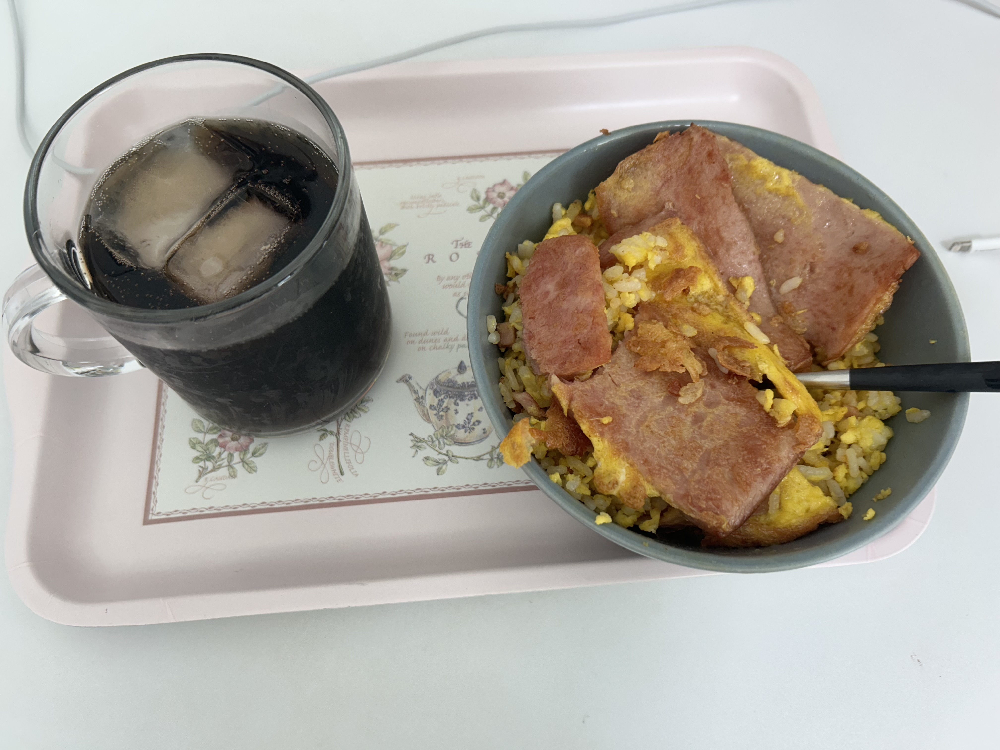

I've recently been trying new things beyond competitive programming and school stuff. I've been looking forward to beginning new hobbies this year since I have more time for myself, and one of them was studying cybersecurity.

I wasn't sure where to start, but I picked up OverTheWire's Bandit problemset. I thought I might as well share my personal notes here for others that might be struggling or are looking for different solutions.

---

**banditX** means how to access **banditX**

**bandit0**
- Basics of `ssh`.
- `ssh -p 2220 bandit0@bandit.labs.overthewire.org`: The argument `-p X` specifies the port as X. After that follows the `username@address`, which is the default.

password: bandit0

---

**bandit1**
- Using `ls` shows a file called 'readme'. Using `file readme` shows that it is a ASCII text file. You can `cat readme` which gives the password.

password: 6y2kwnwK6grgvwvpvLaa2T1cpFEKOhNR

---

**bandit2**
- Using `ls` shows a file callled '-'. It is an ASCII text file. You can `cat ./-` to view it; since you cannot type '-' as raw text, we specify the directory instead.

password: PK8fYLZg2hnHSz83plBL1iEPKdD3QToB

---

**bandit3**
- There is a file named '--spaces in this filename'. Since there are spaces, we can group them as a string. './--spaces in this filename'. You can also use double quotations. You still need to use ./ here though.

password: 7ZZ2LFrykP2zEyvBl4m3clcL7tGYJPME

---

**bandit4**
- You can enter directories using `cd`, so `cd inhere` works. `ls -a` and `ls -A` both show '...Hiding-From-You'. `cat ...Hiding-From-You` gives the password.

password: xzTXq1rDJQVVAzdv5cHq1TQytTWufAMq

---

**bandit5**
- There are many files, but we want to view which is human readable ASCII text. `*` shows all relevant files following a pattern, so `file ./*` shows the filetypes of all files in the current directory. One of these files will be ASCII text, which is readable.

password: 6C7h9GD8M6ai5nr7wo1RonrzFjj9yIrG

---

Also, I've been cooking for about 3 years now! I never really thought about sharing my meals but I thought it might be nice to share my dishes alongside my cybersecurity guides.

Today I was pretty busy, so all I made was simple egg fried rice with spam on top.
You whisk up some eggs, pour it into your rice so it simmers into the individual grains, and then stir fry it. I added the spam on top because I like spam.

{: width="600"}
