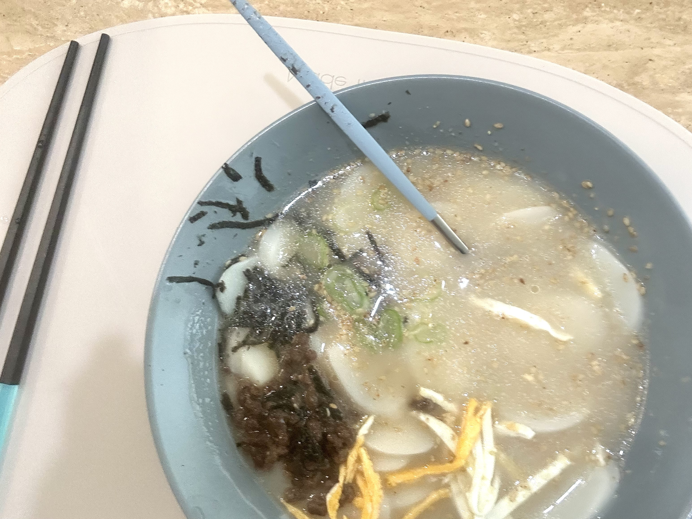

More Bandit. I have zero experience when it comes to shell commands, so it's taking me a bit to get used to the syntax. But it's pretty fun since it feels like I'm learning a new language.

---

**banditX** means how to access **banditX**

**bandit6**
- There's a lot to learn in this section, but I think the finalized command tells enough.
- `find . -type f -size 1033c -exec file {} + | grep -w text` should give a list of matching files.
- `find` command returns a list of files matching the given arguments. `.` specifies the directory. By default, it looks through infinite depth, meaning all children files of the specified directory. `-type f` specifies that the type of the file should be a regular file. `-size 1033c` means the filesize should be precisely 1033 bytes. The main `find` command ends here.
- Following that is `-exec file {} +`. `-exec` means the following command will be ran for each result of the previous command. The results will be placed individually in the placeholder `{}`. Here, we are using `file` to view the file type in detail. `+` ends the expression, but also merges the multiple commands into one. So it would look like `file a.txt b.txt c.txt ...` behind the scenes. You can do `\;` which executes the command once per file, but `+` is faster when compatible.
- `| grep -w text` follows, which just pipes the results and view if any of the results have the word 'text'. `-w` specifies that we are looking for the full word 'text', so entries like 'textile' isn't caught. You don't need to put 'text' in quotes, but doing so gives the same result.

password: pXa26xhMWaC2SvDotA4r9EgZkulOeSBW

---

Today's dish is tteok-guk, which is a traditional korean soup with ricecakes floating inside. It's as simple as making ramen. You add sliced frozen ricecakes to a pot of yook-so(beef broth) and boil it until the ricecakes soften. It's nice to add spices of your choice. I just added a seasoning pack and some salt. I fried an egg and sliced it into slits alongside seaweed paper to have it on top. I also added fresh chopped scallions to enhance the flavor.

{: width="600"}
