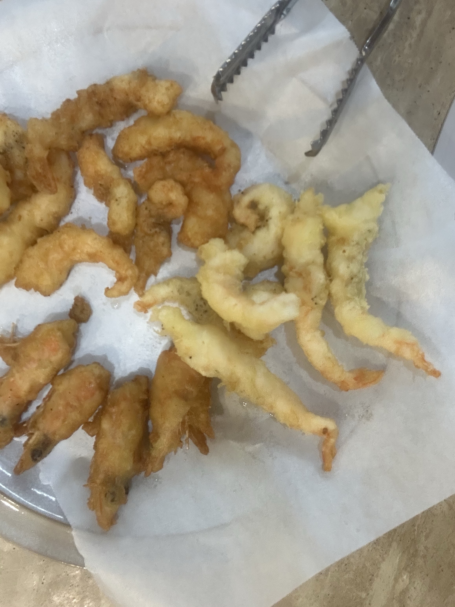

Bandit seems pretty enjoyable so far. I don't have much to say beyond the actual guide.

---

**banditX** means how to access **banditX**

**bandit7**
- The conditions say owned by user bandit7, and owned by group bandit6. While unnecessary, it's nice to verify if we are in that group. `groups` returns a list of groups that we are in. This confirms we are part of that group.
- `-user {x}` and `-group {x}` are arguments in `find` that specify files owned by a user or group.
- Doing `find . -type f -size 33c -user bandit7 -group bandit6` might have worked if we were looking for files in our home directory. However, using `ls` shows there are no files here.
- We can search from the root instead. Therefore, the following command does the job: `find / -type f -size 33c -user bandit7 -group bandit6`
- However, another problem is that we get a bunch of error messages. If you look real hard, you will find the appropriate result, but it's uncomfortable to look for it. `grep` could temporarily do the job, but a more standard workaround is redirecting file descriptor 2, being `stderr`, to `/dev/null` which is a device that discards anything. Essentially, we're just discarding the `stderr` outputs. We can do this by adding `2>/dev/null` to the end of our command.
- Thus, a finalized command would look like: `find / -type f -size 33c -user bandit7 -group bandit6 2>/dev/null`

password: Bmnnvf82KzQlfxgAI2d1zYbr1u9pr3E3

---

I tried frying shrimp for the first time today. I didn't use those microwavable shrimps and got raw shrimp instead from the supermarket. I watched this video once on youtube about how to shuck every shellfish, and I just used knowledge I remembered to work with it.

You put on some latex gloves and break off the heads, and peel the shell of the shrimp back before splitting the flesh  in half. It's like butterflying shrimp but going all the way through. What's nice about this is that you can just pull back the intestinal track with your hands if you slit it in half like this. Then you coat the shrimp flesh and heads in flour before dipping them in a batter (any batter should be fine as long as it's decently thick). All you have to do is fry them twice in hot oil. I think I left them in the oil for too long, so they turned out a bit dark this time. But they tasted really good! I could really taste the savory shrimp taste that's not really present in microwaved shrimp fries sold at the grocery store.

{: width="600"}
