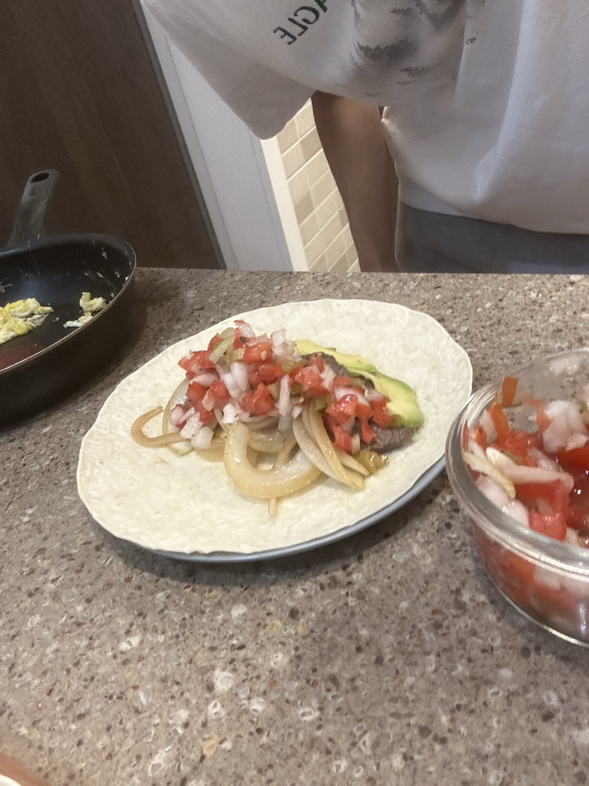

It feels like until now, it's mostly just learning and practicing the syntax. Not much critical thinking to it but it's still fun being able to do something in linux at last lol

---

**banditX** means how to access **banditX**

**bandit8**
- It's nice to first read `data.txt`. It shows a word and a password next to it, like a database of usernames and passwords. This means that all we have to look for is the word 'millionth' here. It will most likely only appear once, which helps.
- Therefore, typing the naive `cat data.txt | grep millionth` isn't a bad idea. `grep millionth data.txt` works the exact same, and is probably better.

password: VR1ljMayciFxbnUokuQmJFw6QC9VKtub

---

**bandit9**
- Knowledge on `uniq` is essential for this task. Essentially it's like `grep` but has different filtering features outside of searching for words, often focusing more on uniqueness and number of appearances. Just like `grep` it can be piped.
- The `-u` flag prints only the unique lines. After hearing this, `cat data.txt | uniq -u` sounds like it should work. However, like C++, you can't filter unique without sorting. This should make sense in terms of time complexity.
- `sort` does that job. I'm unsure of how the sorting works in detail, but I think it sorts by lines. There are various flags for various purposes, but since each line has one word, we're sure that the default should work.
- Additionally, `sort` just prints the sorted version. It does not make modifications to the original file.
- Thus, `sort data.txt | uniq -u` should do the job.

password: EjmOSvuAu7sGAHqHVcBDPirRe9T03kxl

---

Tacos for friday dinner! It's one of my favorite dishes to make, and I'd say one of my best ones. I try to make everything from scratch (except for the tortilla), and it's not as bad as people expect. I can't say my tacos are authentic, but they are pretty good in their own way.

I make my own salsa, which uses four ingredients and four spices. I begin with chopping up some cilantro and jalapenos, then dice tomatoes and onions at approximately a 1:1 ratio. I then add lime juice, salt, sugar, and pepper. I eyeball this so I can't really put a finger on the exact numbers, but adding enough lime juice so that the sauce is wet and adjusting the rest as you test the taste (because tomato taste varies heavily) helps.

I then grill some beef with chopped onions then slice up some avocadoes as well. I occasionally put in scrambled eggs because it's difficult to find thin rice suitable for tacos or burritos.

One tip is to toast your tortillas lightly so that it's more pliant and you taste less flour on your teeth when you bite into it.

{: width="600"}
