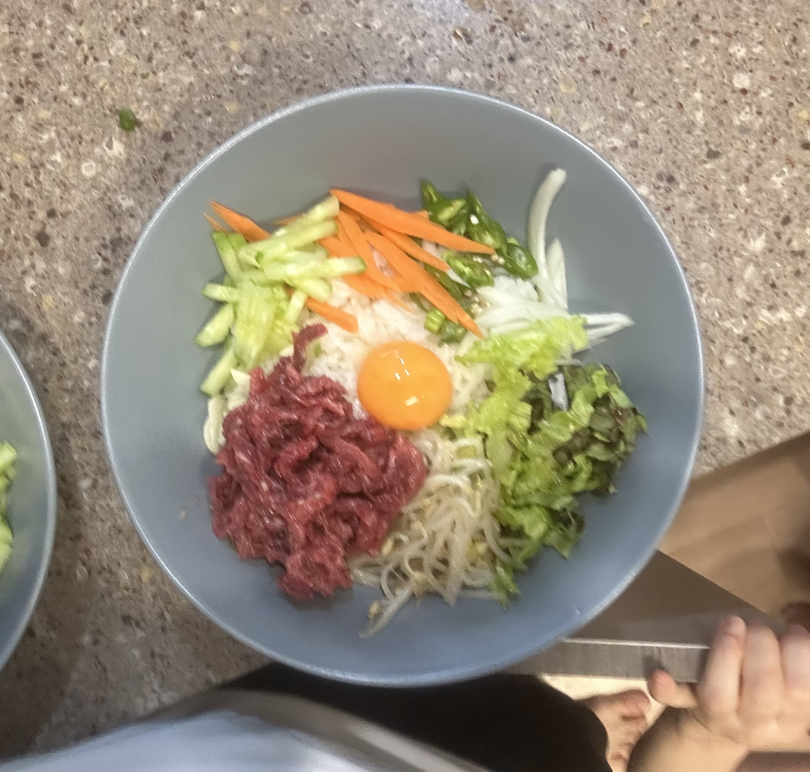

Though it is super basic encoding and decoding, it feels like I'm getting to think a little. It still is pretty difficult learning and getting used to so much new syntax, but going through it multiple times personally helped.

---

**banditX** means how to access **banditX**

**bandit10**
- `file data.txt` gives data. `grep` doesn't work as expected, giving "grep: (standard input): binary file matches". This is because `grep` avoids printing unreadable binary and only reports that a match exists (as shown now). using the flag `-a` or `--text` allows you to bypass this. Since the task said several '=' characters, doing `grep -a == data.txt` gives a readable amount.
- We can improve this, and in fact remove the flag. `strings` returns all human-readable strings. Thus, we can do the following: `strings data.txt | grep ==`

password: B0s2khmbT9u0geKuOoVGW3JZKhndE3BG

---

**bandit11**
- This one's simple. `data.txt` stores a base64 encoded version of a text. Using `man base64` shows that you can use the flag `-d` to decode a file encoded in base64.
- Thus, `base64 -d data.txt` solves it.

password: pYfOY6HwUsDj5rL9UvyhU7MCmv8vN5Ro

---

**bandit12**
- Rot13 is a simple encoding that wikipedia explains well. All we need to do is translate A-Z to N-Z and A-M, along with the lowercase variants as well.
- `tr` is the command for it. It translates a certain range of characters to a new range of characters. You can also use it to delete characters.
- In our case, we would want to do something like `tr 'A-Za-z' 'N-ZA-Mn-za-m'`. You should quote the from range and to range, and represent ranges as so.
- One thing about `tr` is that it doesn't accept a file as an argument. You either pipe it, direct input with `< input` after the command, or type input directly and quit.

password: GROozWPO8QyN0mGrjUkID0WCYkZiQxrN

---

Simple beef sashimi rice tonight. I'm not too proud of how this dish turned out visually, but it tasted really good. Beef sashimi (yuk-hwe) is something we eat in Korea but I think it might be difficult to get the right ingredients for in other countries. I don't know exactly which part of the cow the beef is from, because I used store bought sashimi.

I chopped up various vegetables that would go well along with it and added an egg yolk at the top. We call this bibim-bap in Korea. It stems from Korean culture where we would stir rice with all sorts of vegetables.

{: width="600"}
