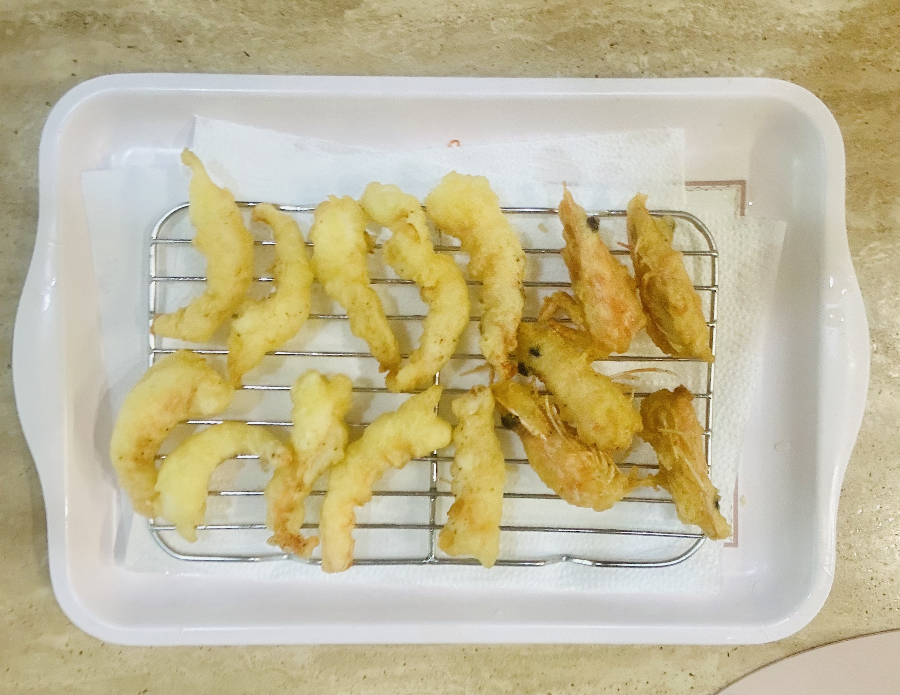

For those wondering what happened over levels 13~22, it was mostly really easy stuff involving using new commands OR really difficult stuff that I didn't write down anything while trying to solve.

This was my first time writing shell scripts. It didn't really feel like writing a script though because the only thing that felt script-ish was using variables. It was still cool though.

---

**banditX** means how to access **banditX**

```sh
#!/bin/bash

myname=$(whoami) #bandit23
mytarget=$(echo I am user $myname | md5sum | cut -d ' ' -f 1) #8ca319486bfbbc3663ea0fbe81326349

echo "Copying passwordfile /etc/bandit_pass/$myname to /tmp/$mytarget"


cat /etc/bandit_pass/$myname > /tmp/$mytarget
```

password: gKXDTAXnIz3OBxiPjRZ2uqutUlPZrBsw

---

I tried making shrimp fries again this time! I went to a harbor to get fresh shrimps at a good price. It was definitely an experience. I ended up buying a lot of crabs too, which I'll probably try cooking somehow tomorrow. I'm not exactly sure how I'll make use of them, but they were live and fresh.

I did the exact same thing as last time, but I just tried to be more careful when frying the shrimp. It turned out much better, and it's definitely a dish I would recommend to others because it's easy to make and definitey a treat.

I also tried making a sauce with vinegar, salt, and pepper. It doesn't sound the best, but I tried it at a japanese restaurant and it was really good. Apparently it's a traditional sauce from japan!

{: width="600"}
