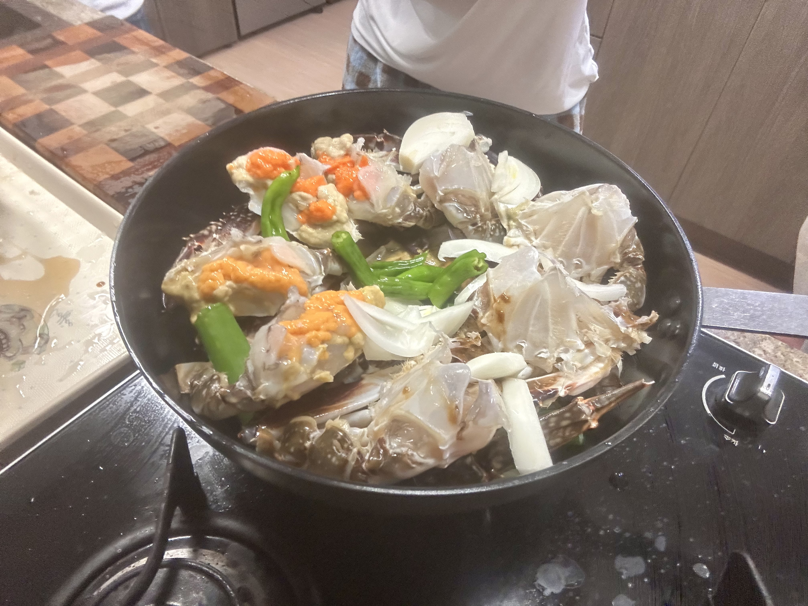
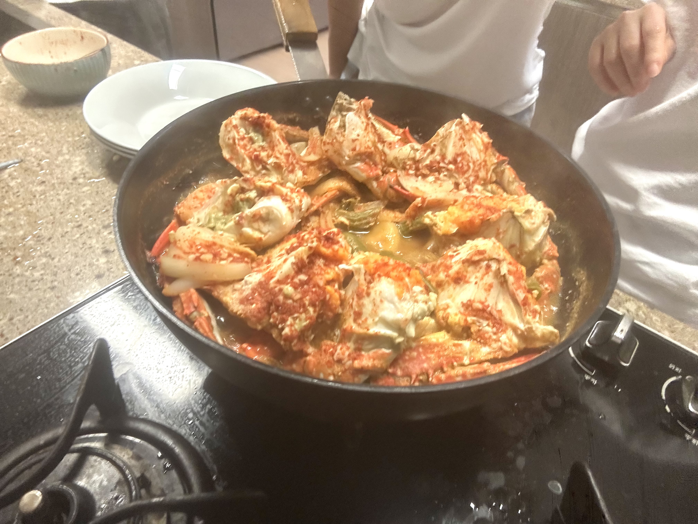

It felt much more like writing a script this time. I'm surpried you can use for loops in for scripts, but yet again scripting anything is sorta impossible without a for loop.

---

**banditX** means how to access **banditX**

```sh
#!/bin/bash

shopt -s nullglob

myname=$(whoami) #bandit24

cd /var/spool/"$myname"/foo || exit 
echo "Executing and deleting all scripts in /var/spool/$myname/foo:"
for i in * .*;
do
    if [ "$i" != "." ] && [ "$i" != ".." ];
    then
        echo "Handling $i"
        owner="$(stat --format "%U" "./$i")"
        if [ "${owner}" = "bandit23" ] && [ -f "$i" ]; then
            timeout -s 9 60 "./$i"
        fi
        rm -rf "./$i"
    fi
done
```

```sh
#!/bin/bash
cat /etc/bandit_pass/bandit24 > /tmp/tmp.lSw9G6Li2o/bandit24pass
```

password: hVQMk3lJNsmQ7VF3ubyrNNBom7BOgVXv

---

Today I made probably my most difficult dish. My grandmother taught me how to make gae-tang, which is basically steamed crab soup.

I had to start with preparing the crab. You lift its apron and snap it off, before shoving your finger against the crack and cracking it open. You keep the guts and snap off the upper half from the bottom half. I ripped off the gills before using a brush to scrub off any grime from the shells. One part that made me worried was I saw these little parasite-like red dots inbetween the gills (even thinking about it make me cringe). But my grandmother told me it's okay, and I'm find at the moment.

I did this for four crabs (2 male 2 female) and snapped them each in half to make 8 segments. I ordered them across the pan as so. I added sliced radishes in them to prepare the basis.

{: width="600"}

After that, my grandmother helped me make the sauce. I honestly don't remember much beyond the fact that the base of the sauce was gochu-jang (red pepper paste)

And if you let it cook for a while, voila. It tasted as good as it looked.

{: width="600"}
