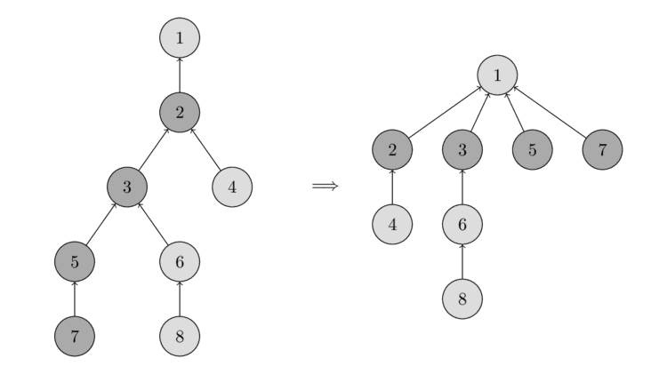

Three basic operations in the structure:

- make_set(v): creates a new set consisting of new element v
- union_sets(a, b): merges two sets where a and b are each located
- find_set(v): returns the representative root node of the set that contains element v

The naive implementation isn’t worth talking about. Just keep track of roots and connect roots to roots.

This way searching inside the DSU is super slow. So we need to make it faster. 

# Path Compression Optimization

The deeper the nodes, the longer it takes to reach each parent. So instead, we set each child directly to the new parent.

{: width="400"}

This achieves average logarithmic time but it’s oftentimes too vague and not good enough for use

# Union by size/rank

We improve our previous optimization by creating an order of merging, meaning which one merges to which one. There are many ways to do this, but the most popular are by depth and size.

```cpp
//path compression optimization
int find_set(int v) {
    if (v == parent[v])
        return v;
    return parent[v] = find_set(parent[v]);
}

//union by size
void make_set(int v) {
    parent[v] = v;
    size[v] = 1;
}

void union_sets(int a, int b) {
    a = find_set(a);
    b = find_set(b);
    if (a != b) {
        if (size[a] < size[b])
            swap(a, b);
        parent[b] = a;
        size[a] += size[b];
    }
}

//union by depth = rank
void make_set(int v) {
    parent[v] = v;
    rank[v] = 0;
}

void union_sets(int a, int b) {
    a = find_set(a);
    b = find_set(b);
    if (a != b) {
        if (rank[a] < rank[b])
            swap(a, b);
        parent[b] = a;
        if (rank[a] == rank[b])
            rank[a]++;
    }
}
```

This way we can guarantee logarithmic operations instead of having random variation with worst case linear.
